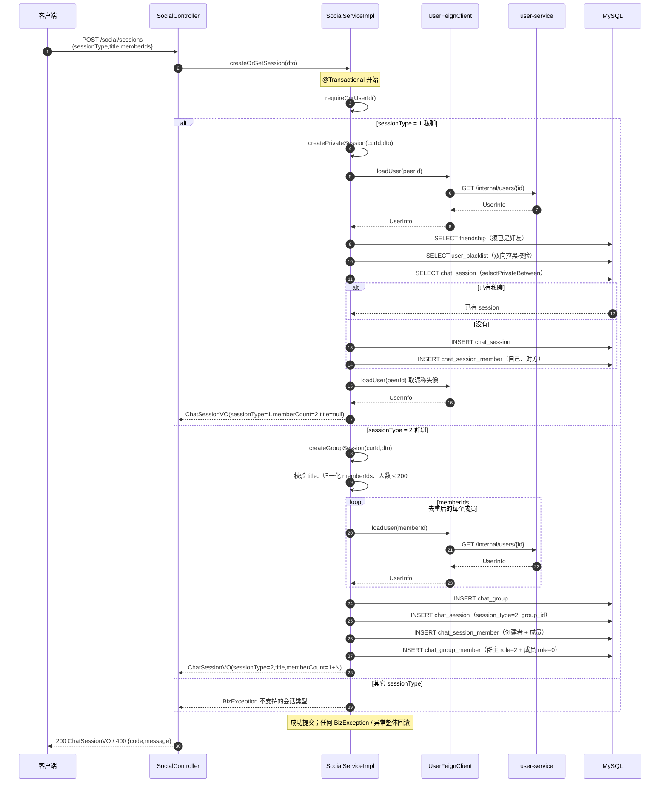
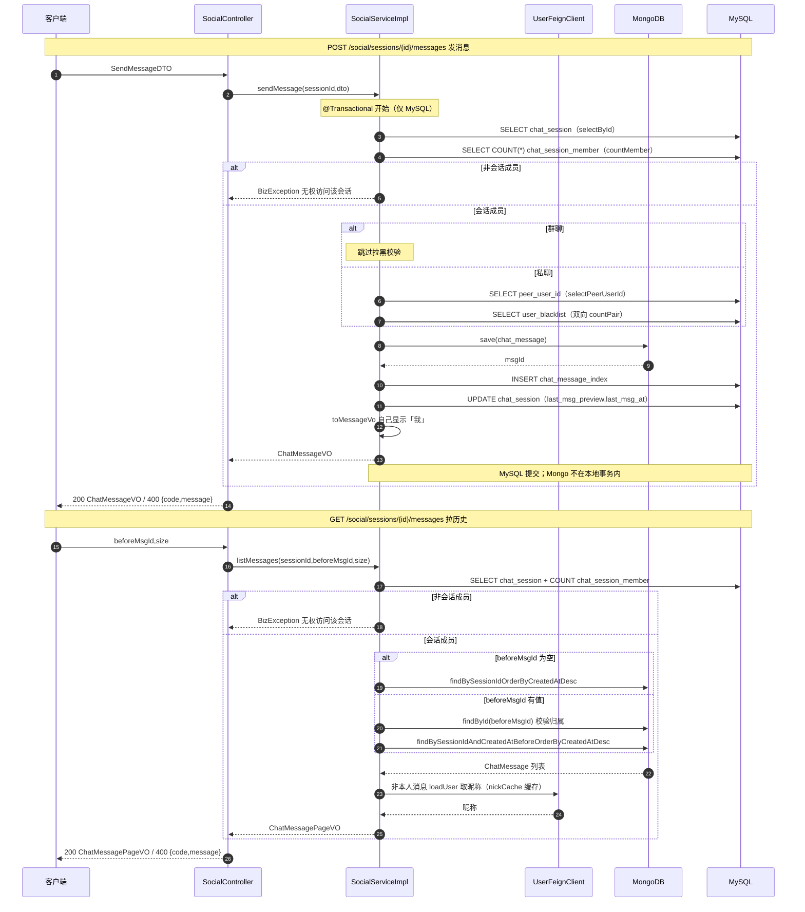

# 群聊实现讲解

## 1. POST /social/sessions 创建会话

## 2. 群聊发消息 / 拉历史

## 3. 分层调用链表

| Controller | Service | Mapper | 表 |
|---|---|---|---|
| `createOrGetSession` 接 `POST /social/sessions` 不开启事务 | `createOrGetSession` 登录校验、按 `sessionType` 分流 事务：`@Transactional` 整体包裹 | — | — |
| — | `createPrivateSession` 好友校验、双向拉黑校验、私聊判重 事务：并入上层事务 | `ChatSessionMapper.selectPrivateBetween` `SELECT ... FROM chat_session s JOIN chat_session_member a/b WHERE s.session_type=1` | `chat_session`、`chat_session_member` |
| — | `createPrivateSession` → `insertMember` 新建时写会话两行成员 事务：并入上层事务 | `ChatSessionMapper.insert` `INSERT INTO chat_session (session_type,peer_user_id,group_id)` `ChatSessionMemberMapper.insert` `INSERT INTO chat_session_member (session_id,user_id,unread_count)` | `chat_session`、`chat_session_member` |
| — | `createGroupSession` title 校验、成员归一化、人数校验、逐个 Feign 校验 事务：并入上层事务 | — | — |
| — | `createGroupSession` 写群 | `ChatGroupMapper.insert` `INSERT INTO chat_group (name,owner_user_id,avatar_url,notice,max_members,status)` | `chat_group` |
| — | `createGroupSession` 写群会话，`peer_user_id=null` | `ChatSessionMapper.insert` `INSERT INTO chat_session (session_type,peer_user_id,group_id)` | `chat_session` |
| — | `createGroupSession` → `insertMember` 创建者与成员各一行，`unread_count=0` | `ChatSessionMemberMapper.insert` `INSERT INTO chat_session_member (session_id,user_id,unread_count)` | `chat_session_member` |
| — | `createGroupSession` → `insertGroupMember` 群主 role=2，成员 role=0 | `ChatGroupMemberMapper.insert` `INSERT INTO chat_group_member (group_id,user_id,role,nickname_in_group)` | `chat_group_member` |
| `sendMessage` 接 `POST /social/sessions/{id}/messages` | `sendMessage` 成员校验、私聊拉黑校验、消息参数校验 事务：`@Transactional`（仅 MySQL） | `ChatSessionMapper.selectById`、`ChatSessionMemberMapper.countMember`、`UserBlacklistMapper.countPair` | `chat_session`、`chat_session_member`、`user_blacklist` |
| — | `sendMessage` 正文落 Mongo | `ChatMessageRepository.save` `db.chat_message.insertOne(...)` | `chat_message`（MongoDB） |
| — | `sendMessage` 写索引与刷新预览 | `ChatMessageIndexMapper.insert` `INSERT INTO chat_message_index (mongo_msg_id,session_id,from_user_id,msg_type,created_at)` `ChatSessionMapper.updateLastMessage` `UPDATE chat_session SET last_msg_preview=?,last_msg_at=?` | `chat_message_index`、`chat_session` |
| `listMessages` 接 `GET /social/sessions/{id}/messages` | `listMessages` 成员校验、游标分页、昵称补全 事务：无写事务 | `ChatSessionMapper.selectById`、`ChatSessionMemberMapper.countMember`、`ChatMessageRepository.findBySessionIdOrderByCreatedAtDesc` / `findBySessionIdAndCreatedAtBeforeOrderByCreatedAtDesc` | `chat_session`、`chat_session_member`、`chat_message`（MongoDB） |

## 4. 输入 → 结果

| 输入 | 结果 |
|---|---|
| `title` 为空或只有空白 | 400 `{"code":400,"message":"群名称不能为空"}`，不落库 |
| `title` 长度 > 128 | 400 `{"code":400,"message":"群名称不能超过128字"}`，不落库 |
| `memberIds` 为 null 或空数组 | 400 `{"code":400,"message":"群成员不能为空"}`，不落库 |
| `memberIds` 只含自己（如当前用户 2 传 `[2]`） | 400 `{"code":400,"message":"群成员不能为空"}`，不落库 |
| 去重后 1 + 成员数 > 200 | 400 `{"code":400,"message":"群成员不能超过200人"}`，不落库 |
| `memberIds` 含不存在用户（如 999） | 400 `{"code":400,"message":"用户不存在"}`，事务回滚，`chat_group`、`chat_session`、`chat_session_member`、`chat_group_member` 均无本次数据 |
| `sessionType` 不是 1 / 2 | 400 `{"code":400,"message":"不支持的会话类型"}`，不落库 |
| 非会话成员拉历史 / 发消息 | 400 `{"code":400,"message":"无权访问该会话"}`，不读写消息 |
| 合法群聊请求 | 200 `{"sessionId":12,"sessionType":2,"title":"黄焖鸡拼车群","memberCount":4,"peerUserId":null,"peerNickname":null,"peerAvatarUrl":null}` |
| 合法私聊请求 | 200 `{"sessionId":9,"sessionType":1,"title":null,"memberCount":2,"peerUserId":2,"peerNickname":"小李","peerAvatarUrl":"https://xxx/b.jpg"}` |
